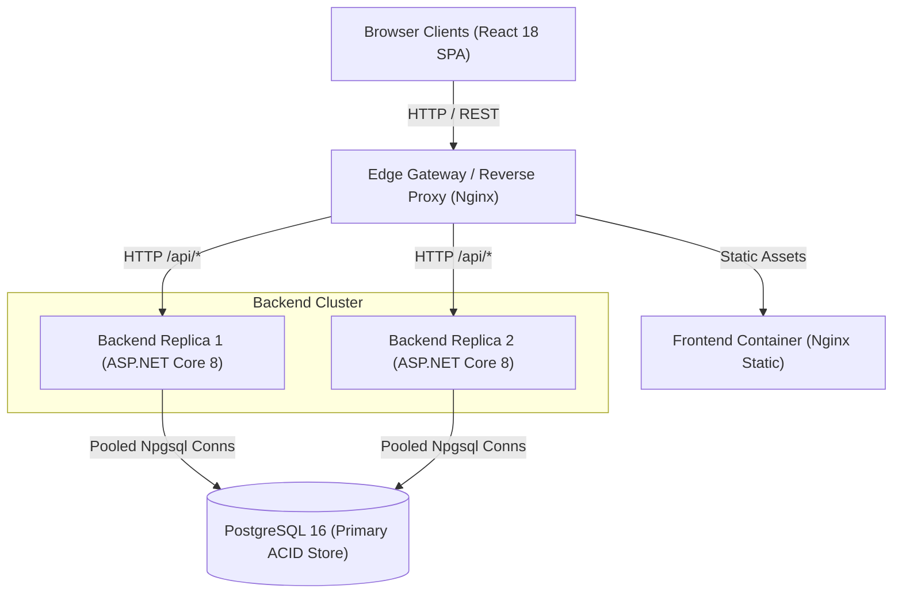
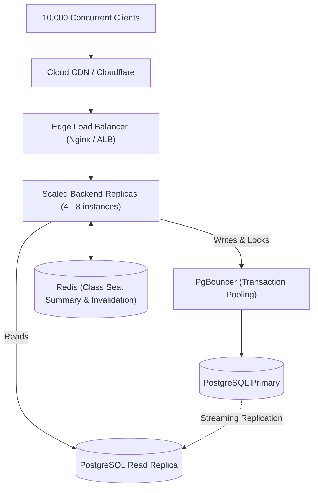
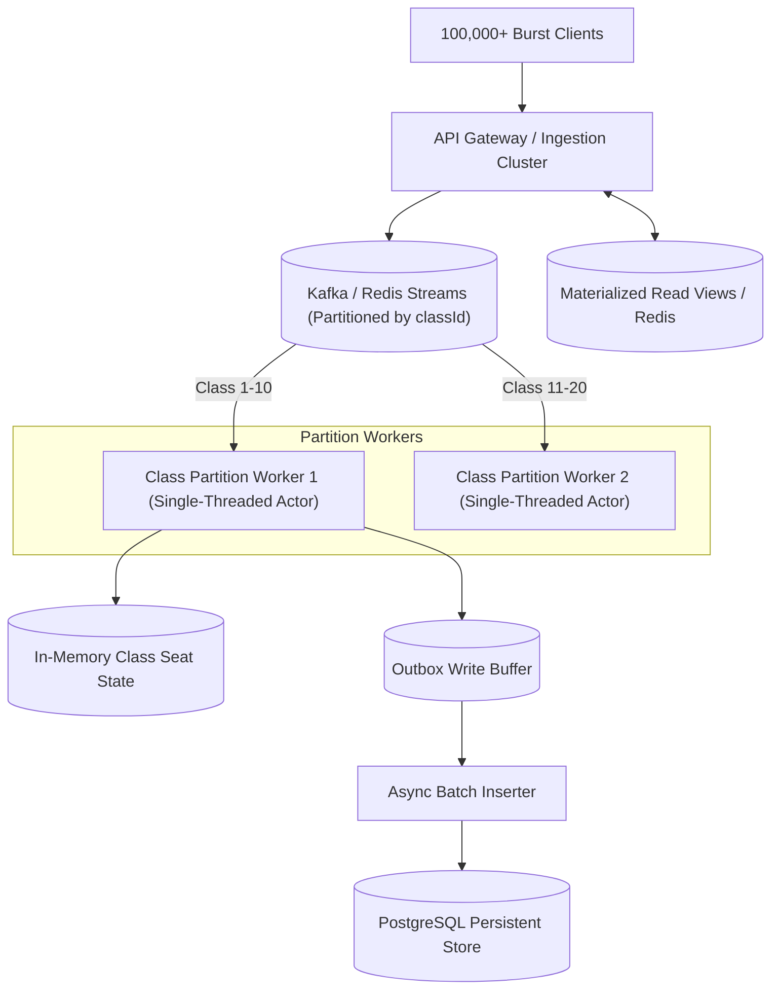

# School Admission System — Architecture Guide

This document describes the architectural evolution of the School Admission System:
1. **Current Production Architecture** (Benchmarked up to 1,000+ VU concurrent stampede).
2. **Architecture A: Evolutionary / Pragmatic Scale** (Scales to 10,000+ concurrent users).
3. **Architecture B: Hyper-Scale Event-Driven Pipeline** (Scales to 100,000+ concurrent users).

---

## 1. Current Production Architecture

The current architecture is intentionally simple, stateless, and mathematically correct. It enforces all Section 1.5 invariants in PostgreSQL without external distributed locks or cache synchronization.

### 1.1 Component Topology

### 1.2 Request Lifecycles

#### A. Read Fast Path (`GET /classes`)
1. Client issues `GET /classes`.
2. Backend receives request and invokes `ClassQueryCoalescer` (SingleFlight pattern).
3. If an identical query is already in-flight and no writes have occurred since, the caller awaits the existing `Task` without issuing a new SQL statement.
4. On query execution, PostgreSQL aggregates `held` and `confirmed` counts using index scans on `classes` and `holds`.
5. The result is returned in < 1ms database query time.

#### B. Write Fast Path (`POST /classes/{id}/holds`)
1. Client passes `X-Student-Id` (17 digits) and `classId`.
2. **Fast Pre-check (Unlocked):** Unlocked SQL query checks if `activeCount >= totalSeats`. If full, immediately returns `409 NO_SEATS_AVAILABLE` without acquiring a lock.
3. **Locking Transaction:**
   - Opens pooled database connection and transaction with `SET LOCAL lock_timeout = '15s'`.
   - `SELECT total_seats FROM classes WHERE id = @classId FOR UPDATE` locks the class row.
   - Synchronizes database clock `clock_timestamp()`.
   - Invariant check 1: Checks for existing active hold for student (`SELECT 1 FROM holds WHERE class_id=@id AND student_id=@sid AND status IN ('HELD','CONFIRMED')`).
   - Invariant check 2: Counts active seats (`COUNT(*) FROM holds WHERE class_id=@id AND status IN ('HELD','CONFIRMED')`).
   - If `activeCount < totalSeats`, inserts new hold with status `'HELD'` and `expires_at = now + HOLD_DURATION_SECONDS`.
   - Commits with `CancellationToken.None` for durability.
   - Triggers `ClassQueryCoalescer.OnWriteOccurred()`.
   - Returns `201 Created` with hold details.

---

## 2. Architecture A: Evolutionary / Pragmatic Scale (~10k Concurrent Users)

When traffic grows to 10,000 concurrent students, direct database connection pools (e.g. 50 connections × 10 backend replicas = 500 connections) exceed optimal PostgreSQL worker limits.

### Key Additions in Architecture A:
1. **PgBouncer Connection Pooling:**
   - Decouples backend application threads from PostgreSQL OS processes.
   - Handles 5,000+ client connections while multiplexing them over 30–50 backend PostgreSQL server processes.
2. **PostgreSQL Read Replicas:**
   - Read queries (`GET /classes`, `GET /me/holds`) route to read replicas using asynchronous streaming replication.
   - Protects the primary write node from aggregate query traffic.
3. **Redis Caching with PostgreSQL Write-Invalidation:**
   - Cache class lists in Redis with 1–2 second TTL or invalidate via PostgreSQL `LISTEN/NOTIFY` triggers upon commit.

---

## 3. Architecture B: Hyper-Scale Event-Driven Pipeline (~100k+ Concurrent Users)

For nationwide school admission events where 100,000+ students submit holds within a 10-second window, any relational database row lock becomes a bottleneck.

### Key Characteristics in Architecture B:
1. **Single-Writer Actor Pattern per Class:**
   - All hold requests for a given `classId` route to a single deterministic thread/worker partition.
   - Zero database locks needed during admission evaluation; seats are allocated in-memory at memory bus speeds (> 500,000 ops/sec).
2. **Asynchronous Batch Persistence:**
   - Allocated holds are pushed to an outbox queue and flushed to PostgreSQL using batch inserts (`COPY` or bulk `INSERT INTO ... VALUES (...)`).
3. **Eventual Consistency on Reads:**
   - Class seat counts are pushed to Redis or WebSockets as real-time materialized views.

---

## 4. Architectural Comparison & Decision Matrix

| Dimension | Current Architecture | Architecture A (Pragmatic Scale) | Architecture B (Hyper-Scale) |
| :--- | :--- | :--- | :--- |
| **Max Concurrent Users** | 1,000 – 3,000 | 10,000 – 25,000 | 100,000+ |
| **Infrastructure Complexity** | Minimal (Backend + Postgres + Nginx) | Moderate (PgBouncer, Redis, Read Replica) | High (Kafka/Streams, Partition Workers, Outbox) |
| **Consistency Model** | Strict Immediate Consistency (ACID) | Immediate Writes, Near-Instant Reads | Eventual Consistency (Async Pipeline) |
| **Operational Overhead** | Low (zero-config, single compose) | Medium (monitoring replication lag & pooler) | High (broker monitoring, partition rebalancing) |
| **Overbooking Risk** | **Zero** (Guaranteed by row locks) | **Zero** (Guaranteed by row locks via PgBouncer)| **Zero** (Single-threaded class partition actor)|
| **Cost** | \$ (Standard single VPS / container host) | \$\$ (Small managed cluster) | \$\$\$ (Dedicated streaming + worker cluster) |
| **When to Choose** | **Recommended for assignment & school scale** | When school district hits > 10,000 active students | Nationwide admissions with 500,000+ applicants |
